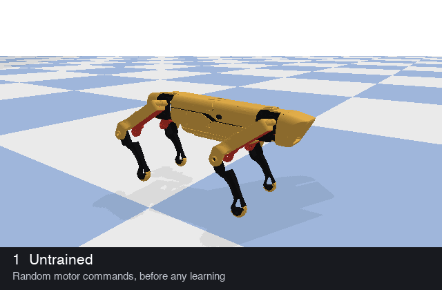
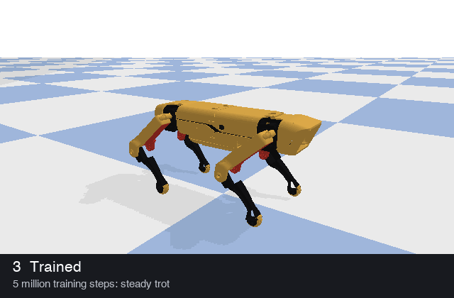

# Teaching a Robot Dog to Walk

I took a 3D-printable SpotMicro (SM3) robot dog, turned it into a simulation with 12 degrees of freedom, and used reinforcement learning to teach it to walk in PyBullet.

| Untrained | Early training | Fully trained |
|:---:|:---:|:---:|
|  |  |  |
| Random motor commands | 200k training steps | 5M training steps |

## How it works

- **The robot:** I built the URDF from the kit's STL files, with 3 motors per leg.
- **The brain:** A PPO policy looks at the robot's balance, joints, speed, and heading, then picks where each motor should go.
- **The goal:** It gets rewarded for trotting forward at 0.3 m/s and penalized for hopping, drifting, or wasting energy.

After 5 million steps, it walked about 6.5 m in 20 seconds, stayed within a few centimeters of a straight line, and didn't fall once in 10 test runs.

## Try it

```bash
git clone https://github.com/zaydenchambers/quadrupe_pybullet_simulation-.git
cd quadrupe_pybullet_simulation-
python3.11 -m venv .venv
source .venv/bin/activate
pip install -r requirements.txt
```

Train it (about 35 minutes on an M4 Mac), then watch it walk:

```bash
python train.py --steps 5000000
python evaluate.py
```

Want to tweak something? Almost all the settings and rewards are in `params.py`.

## What's next

This only runs in simulation so far. The masses, motor strength, and friction are estimates, so the next step is measuring the real robot and making the policy tough enough to survive outside the sim.
